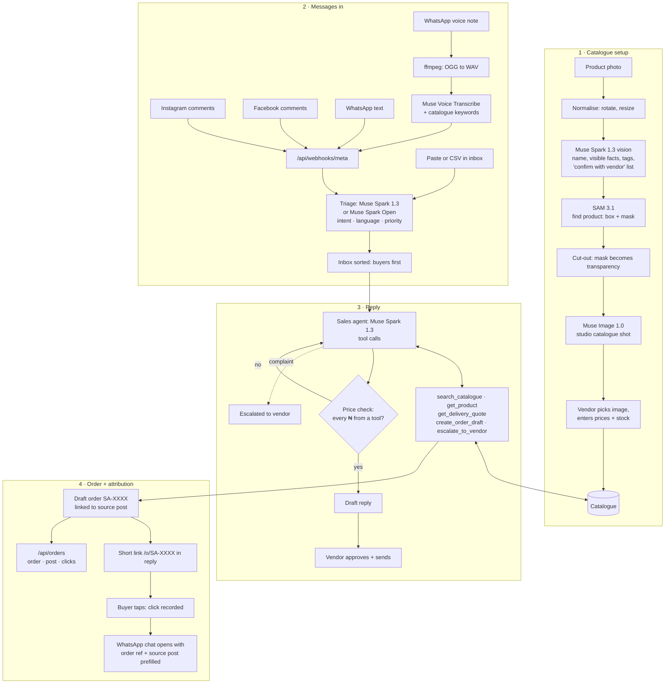

# SellAI

**An AI sales desk for small businesses that sell through Instagram, Facebook and WhatsApp, starting with Nigerian vendors.**

In Nigeria, a huge share of retail happens in comment sections and DMs. A vendor posts a wig and gets hundreds of comments: *"HM?"*, *"abeg how much be this one"*, *"una dey deliver Ibadan?"*, *"Elo ni? Mo fe ra"*. Real buyers are buried in casual engagement, written in Pidgin, Yoruba, Igbo, Hausa or a mix. Vendors miss sales because they can't reply fast enough, and they can't tell which posts actually make money.

SellAI:

1. **Finds the buyers.** Triages every comment and DM by buying intent, in the languages Nigerian customers actually write in.
2. **Drafts grounded replies.** A Muse Spark agent looks up the real catalogue, stock and delivery fees with tool calls, then drafts a reply in the customer's own register. Every Naira amount is checked against tool results before the vendor sees the draft.
3. **Turns photos into listings.** A product photo becomes a named, cut-out, studio-shot catalogue entry; the vendor only sets the price.
4. **Turns intent into orders.** When a buyer is ready, the agent creates a draft order and a short tracked checkout link that opens WhatsApp with the order reference.
5. **Shows which post earned the money.** Every order and link click is tied to the post that produced it.

> Built for the **Meta Global AI Developer Hackathon** (Oct 26 – Nov 4, 2026), theme: *Build for Your World*.
> All code in this repository was written during the hackathon. See the commit history.

## Meta models used

| Job | Model |
|---|---|
| Sales agent: tool calling over catalogue, stock, delivery and orders | Muse Spark 1.3 |
| High-volume comment triage | Muse Spark 1.3, or Muse Spark Open on Baseten |
| WhatsApp voice notes → text, biased with the vendor's own product words | Muse Voice Transcribe 1.0 |
| Photo → listing: name the product and describe only what's visible | Muse Spark 1.3 (vision) |
| Photo → listing: find and cut the product out of the photo | SAM 3.1 |
| Photo → listing: clean catalogue shot from the cut-out | Muse Image 1.0 |

## How it works



### 1. Catalogue setup

On `/catalogue` the vendor uploads a product photo:

1. **Muse Spark 1.3 (vision)** drafts a name, a description of what is visible, and search tags. Anything the photo can't prove (human vs synthetic hair, exact length) goes on a "confirm with vendor" list instead of into the description.
2. **SAM 3.1** finds the product, and its mask becomes the transparency of a cut-out.
3. **Muse Image 1.0** turns the cut-out into a studio shot, with a strict "change nothing about the product" prompt.
4. The vendor picks the image, enters prices and stock, and publishes. The agent can sell the item immediately.

### 2. Messages in

Instagram comments, Facebook comments and WhatsApp messages arrive through one webhook and are normalised into one message shape. WhatsApp voice notes are converted from OGG/Opus to WAV and transcribed by **Muse Voice Transcribe**, with the vendor's product names and delivery cities sent as keyword hints. Comments can also be pasted into the inbox, so the demo never depends on a live webhook.

**Triage** labels every message with intent, language and an English meaning, then sorts the inbox so ready-to-buy messages and complaints come first.

### 3. Reply

When the vendor opens a message, the **sales agent** (Muse Spark 1.3) looks up the real catalogue, stock and delivery fees with tool calls, and drafts a reply in the customer's own language. Before the vendor sees the draft, every ₦ amount is checked against tool results. An amount no tool returned triggers one self-correction and is flagged if it remains. Complaints and refunds always escalate to the vendor. Nothing is sent without the vendor's approval.

### 4. Order and attribution

When a buyer is ready, the agent creates a draft order (`SA-XXXX`) linked to the post the message came from, and puts a short link in the reply. When the buyer taps it, the click is recorded and WhatsApp opens with the order reference and source post filled in. `/api/orders` lists each order with its source post and click count.

### Roadmap

- [ ] Attribution dashboard: revenue per post and the enquiry → click → order funnel
- [ ] Read the order reference from incoming WhatsApp messages and mark the order confirmed
- [ ] Auto-triage messages arriving through the webhook
- [ ] Send approved replies through the WhatsApp Cloud API
- [ ] Persistent database for catalogue and orders

### Key files

- `src/agent/classify.ts` – batched intent triage with zod-validated JSON and one self-correcting retry
- `src/agent/sales-agent.ts` – tool-calling loop with parallel tool execution and a grounding self-repair step
- `src/agent/tools.ts` – the only source of prices, stock and fees the agent may quote
- `src/agent/grounding.ts` – extracts ₦ amounts (₦75,000 · N5000 · 98k · 103,000 naira) and checks each one came from a tool
- `src/ai/transcribe.ts`, `src/ai/audio.ts` – voice note conversion and Muse Voice Transcribe with catalogue keywords
- `src/ai/describe.ts`, `src/ai/segment.ts`, `src/ai/product-image.ts` – Muse Spark vision, SAM 3.1 and Muse Image steps
- `src/catalogue/listing.ts` – the photo-to-listing pipeline and publishing
- `src/integrations/` – Meta webhook normalisation and signature check, WhatsApp send/media, attribution links
- `eval/comments.jsonl` – 60 labelled comments in English, Pidgin, Yoruba, Igbo and Hausa

## Run it

```bash
npm install
cp .env.example .env        # add MODEL_API_KEY
npm run ping                # confirms key + model work
npm run selftest            # offline checks, no key needed
npm run eval                # scores the classifier on the labelled set
npm run agent:demo          # runs the agent on 4 realistic messages and prints tool traces
npm run voice:demo -- note.ogg        # voice note → transcript → intent → reply draft
npm run catalogue:demo -- photo.jpg   # photo → description, SAM cut-out, studio shot → out/
npm run dev                 # http://localhost:3000
```

### Webhooks (optional for the demo)

1. Create an app at developers.facebook.com, add the Instagram, Messenger/Page and WhatsApp products.
2. Expose your dev server (e.g. `ngrok http 3000`) and set the callback URL to `https://<tunnel>/api/webhooks/meta` with `META_WEBHOOK_VERIFY_TOKEN`.
3. Subscribe to `comments` (Instagram), `feed` (Page) and `messages` (WhatsApp). In development mode only accounts with a role on the app trigger events.

The paste/CSV inbox works without any of this, so the demo never depends on a live webhook.

## Guardrails

- The agent never sends anything; every draft waits for the vendor's approval.
- Prices, stock and delivery fees can only come from tool results; ungrounded amounts trigger a self-repair and are flagged in the UI.
- The agent never shares or invents bank details.
- Complaints and refunds always escalate to a human.
- Listings never get AI-generated prices or stock, and AI-enhanced images are labelled so the vendor checks them against the real item.
- No scraping: only the vendor's own posts and messages through Meta's official APIs.
