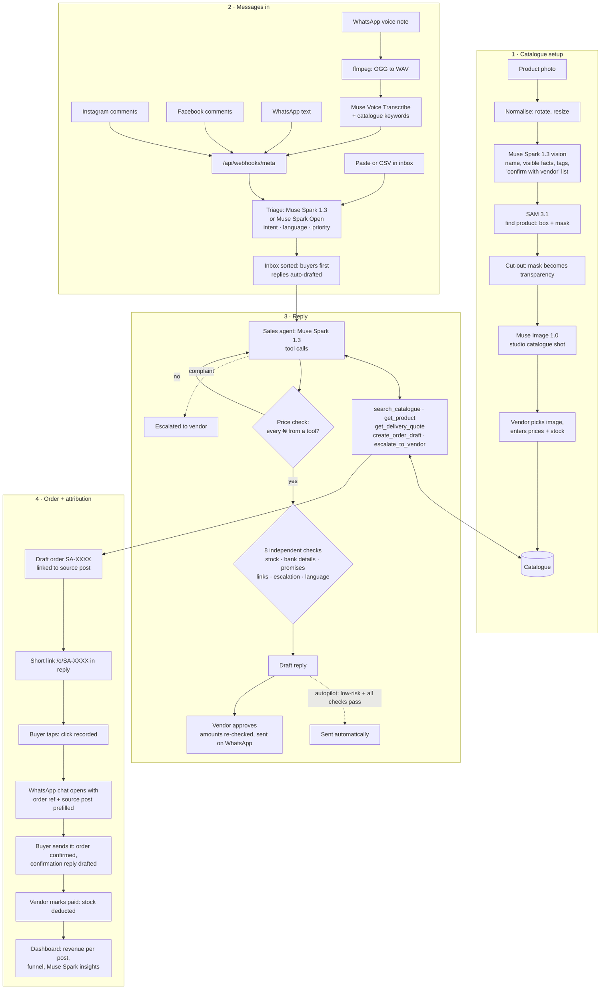

# SellAI

**An AI sales desk for small businesses that sell through Instagram, Facebook and WhatsApp, starting with Nigerian vendors.**

| | |
|---|---|
| 🎬 **Demo video (3 min)** | https://youtu.be/Qn5MVwBAUp4 |
| 🌐 **Live app** | https://sellai-meta.vercel.app |
| 🛍️ **Public shop** | https://sellai-meta.vercel.app/shop |
| 🔑 **Seller pages (for judges)** | https://sellai-meta.vercel.app/login → *Have a shop passcode?* → sellai-judges-2026 |

**Results:** 98.2% intent accuracy on 60 labelled comments in English, Pidgin, Yoruba, Igbo and Hausa (100% recall on ready-to-buy) · 24/24 scripted sales conversations passed with no invented prices · verified live end to end on WhatsApp: question → grounded reply → checkout link → confirmed → paid → revenue on the dashboard.

In Nigeria, a huge share of retail happens in comment sections and DMs. A vendor posts a wig and gets hundreds of comments: *"HM?"*, *"abeg how much be this one"*, *"una dey deliver Ibadan?"*, *"Elo ni? Mo fe ra"*. Real buyers are buried in casual engagement, written in Pidgin, Yoruba, Igbo, Hausa or a mix. Vendors miss sales because they can't reply fast enough, and they can't tell which posts actually make money.

SellAI:

1. **Finds the buyers.** Triages every comment and DM by buying intent, in the languages Nigerian customers actually write in.
2. **Drafts grounded replies.** A Muse Spark agent looks up the real catalogue, stock and delivery fees with tool calls, then drafts a reply in the customer's own register. Every Naira amount is checked against tool results before the vendor sees the draft.
3. **Turns photos into listings.** A product photo becomes a named, cut-out, studio-shot catalogue entry; the vendor only sets the price.
4. **Turns intent into orders.** When a buyer is ready, the agent creates a draft order and a short tracked checkout link that opens WhatsApp with the order reference.
5. **Shows which post earned the money.** Every order and link click is tied to the post that produced it.
6. **Rewards loyal customers.** Recognises repeat buyers across Facebook, Instagram and WhatsApp; Muse Spark suggests a reward within the vendor's limits, and the agent applies it on their next order.
7. **Logs sellers in with WhatsApp.** The seller sends a one-time code from their own number; no passwords.

> Built for the **Meta Global AI Developer Hackathon** (Oct 26 – Nov 4, 2026), theme: *Build for Your World*.
> All code in this repository was written during the hackathon. See the commit history.

## Meta models used

| Job | Model |
|---|---|
| Sales agent: tool calling over catalogue, stock, delivery and orders | Muse Spark 1.3 |
| High-volume comment triage | Muse Spark 1.3, or Muse Spark Open on Baseten |
| WhatsApp voice notes → text, biased with the vendor's own product words | Muse Voice Transcribe 1.0 |
| Photo → listing: name the product and describe only what's visible | Muse Spark 1.3 (vision) |
| Photo → listing: find and cut the product out of the photo | SAM 3.1 |
| Photo → listing: clean catalogue shot from the cut-out | Muse Image 1.0 |

## How it works



### 1. Catalogue setup

On `/catalogue` the vendor uploads a product photo:

1. **Muse Spark 1.3 (vision)** drafts a name, a description of what is visible, and search tags. Anything the photo can't prove (human vs synthetic hair, exact length) goes on a "confirm with vendor" list instead of into the description.
2. **SAM 3.1** finds the product, and its mask becomes the transparency of a cut-out.
3. **Muse Image 1.0** turns the cut-out into a studio shot, with a strict "change nothing about the product" prompt.
4. The vendor picks the image, enters prices and stock, and publishes. The agent can sell the item immediately.

### 2. Messages in

Instagram comments, Facebook comments and WhatsApp messages arrive through one webhook, which answers Meta immediately and does the work in the background. Messages are saved once (Meta retries webhooks, so saving is idempotent) and normalised into one shape. WhatsApp voice notes are converted from OGG/Opus to WAV and transcribed by **Muse Voice Transcribe**, with the vendor's product names and delivery cities sent as keyword hints. Comments can also be pasted into the inbox, so the demo never depends on a live webhook.

**Triage** labels every message with intent, language and an English meaning, then sorts the inbox so ready-to-buy messages and complaints come first. Messages that need an answer get a reply drafted automatically, so it's waiting when the vendor opens the inbox.

### 3. Reply

For each message that needs an answer, the **sales agent** (Muse Spark 1.3) looks up the real catalogue, stock and delivery fees with tool calls, and drafts a reply in the customer's own language. Before the vendor sees the draft, every ₦ amount is checked against tool results. An amount no tool returned triggers one self-correction and is flagged if it remains. Complaints and refunds always escalate to the vendor. Nothing is sent without the vendor's approval, and if the vendor edits the draft, every ₦ amount is checked again before it goes out. WhatsApp replies are sent through the WhatsApp Cloud API; comment replies are copied for the vendor to paste.

### Checks and autopilot

After the agent drafts a reply, **eight checks run in code**, outside the agent's control:

| Check | Blocks sending? |
|---|---|
| Every ₦ amount came from a tool result | yes |
| Enough stock for any order in the reply | yes |
| No bank or account details (10-digit NUBAN, bank name + number) | yes |
| No promises the agent has no tool for: reserve, hold, discount, free delivery, refund, guarantee | yes |
| Every link is the real checkout link for this order | yes |
| Complaints are escalated to the vendor | yes |
| Reply matches the customer's language (Pidgin / English) | warns |
| Short enough for chat | warns |

The same checks run again when the vendor approves, so an edit can't slip in an invented price or an account number. The vendor can still send a held reply on purpose.

**Autopilot** (a switch in the inbox, off by default) sends a reply without waiting only when all of these hold: it's a WhatsApp message; it's a price, delivery, stock or product question; triage is confident; the reply creates no order and isn't escalated; and every check passes, warnings included. Orders, complaints and anything flagged always wait for the vendor. Each draft says why autopilot sent it or held it.

### 4. Order and attribution

When a buyer is ready, the agent creates a draft order (`SA-XXXX`) linked to the message and the post it came from, and puts a short link in the reply. When the buyer taps it, the click is recorded and WhatsApp opens with the order reference filled in. When they send that message, the order is confirmed automatically and a confirmation reply is drafted using the exact figures from the order. The vendor marks it paid, which deducts stock.

### 5. Dashboard

`/dashboard` answers "which of my posts actually brings in money?". For each post it shows messages, buyers found, links opened, confirmed and paid orders, revenue, buyer-to-paid conversion and average reply time, plus the overall funnel. **Muse Spark insights** read only those aggregated numbers and suggest what to post next. Any insight quoting a ₦ amount that isn't in the data is dropped, and a small-sample warning is added in code when there are fewer than 5 orders.

### 6. Loyal customers and rewards

`/customers` turns order history into a customer list. A buyer who commented on a Facebook post, confirmed on WhatsApp and came back through Instagram is **one customer**, known by their WhatsApp number, with the Facebook name they were first seen as. Filter by where they bought (Facebook, Instagram, WhatsApp).

- **Tiers, in code:** New (1 paid order) → Returning (2) → Loyal (3+ orders or ₦200,000+) → VIP (5+ or ₦400,000+). A loyal customer with no purchase in 45 days is flagged **going quiet**.
- **Muse Spark suggests the reward** for each customer (percent off, amount off, free delivery, or a gift from stock that suits their favourite product) and writes a short thank-you in their language. **The rules decide what's allowed:** at most 10% off, cash discounts capped at 10% of their average order, gifts only from in-stock items worth at most 20% of what they've spent. Anything outside the limits is capped or changed, and the vendor sees what was adjusted.
- **The AI never writes the money.** The reward line ("🎁 10% off your next order…") is fixed text generated from the reward itself, and the personal message goes through the same independent checks as sales replies: an invented ₦ amount, bank details or a stray link blocks it.
- **Redeemed automatically.** When that customer next orders on WhatsApp, the sales agent's `create_order_draft` tool applies the reward and returns the discount, so the agent can mention it and the grounding check still holds. A buyer who started on Facebook gets it at confirmation, once their WhatsApp number is known. The reward is marked used when the order is paid.
- **WhatsApp's 24-hour rule is respected:** within 24 hours of the customer's last message the thank-you goes out through the Cloud API; otherwise SellAI opens WhatsApp with the message filled in for the vendor to send from their own phone.

### Seller login

The inbox, catalogue, analytics and customer pages, and every `/api/*` route except the Meta webhook, need a signed-in seller (`proxy.ts`). The shop, landing page, checkout links and privacy page stay public.

- **Log in with WhatsApp, the other way round.** The seller enters their number, SellAI shows a one-time code, and the seller sends `SellAI login 123456` *from their own WhatsApp* to the shop's number. The signed Meta webhook tells us which number sent it, which proves the seller controls that WhatsApp account, and the login page signs itself in. Because the seller starts the chat, no WhatsApp authentication template (and no template approval) is needed. Codes are single-use, expire after 10 minutes, are bound to the browser that asked for them, and only work for numbers in `SELLER_WHATSAPP_NUMBERS`. Login messages never appear in the inbox.
- **Optional passcode** (`SELLER_PASSCODE`) for a shop assistant or for judges without the seller's phone.
- Sessions are HMAC-signed cookies (`SESSION_SECRET`), httpOnly, 7 days.

### Roadmap

- [x] Attribution dashboard: revenue per post and the enquiry → click → order funnel
- [x] Read the order reference from incoming WhatsApp messages and mark the order confirmed
- [x] Auto-triage and auto-draft messages arriving through the webhook
- [x] Send approved replies through the WhatsApp Cloud API
- [x] Persistent database (Supabase Postgres, or local PGlite with no setup)
- [x] Independent verification checks and autopilot for low-risk replies
- [x] Agent scenario test suite (24 scripted conversations)
- [x] Loyal customers: tiers, AI-suggested rewards within vendor rules, automatic redemption on the next order
- [x] Seller login with WhatsApp (reverse OTP) and optional passcode
- [ ] Facebook Login for sellers
- [ ] Reply to Instagram and Facebook comments through the Graph API
- [ ] Approved WhatsApp templates for thank-you messages outside the 24-hour window

### Key files

- `src/agent/classify.ts` – batched intent triage with zod-validated JSON and one self-correcting retry
- `src/agent/sales-agent.ts` – tool-calling loop with parallel tool execution and a grounding self-repair step
- `src/agent/tools.ts` – the only source of prices, stock and fees the agent may quote
- `src/agent/grounding.ts` – extracts ₦ amounts (₦75,000 · N5000 · 98k · 103,000 naira) and checks each one came from a tool
- `src/agent/checks.ts` – the eight independent reply checks
- `src/inbox/autopilot.ts` – the policy for which replies may send themselves
- `eval/agent-scenarios.ts`, `scripts/agent-eval.ts` – 24 scripted conversations scored against the real agent
- `src/ai/transcribe.ts`, `src/ai/audio.ts` – voice note conversion and Muse Voice Transcribe with catalogue keywords
- `src/ai/describe.ts`, `src/ai/segment.ts`, `src/ai/product-image.ts` – Muse Spark vision, SAM 3.1 and Muse Image steps
- `src/catalogue/listing.ts` – the photo-to-listing pipeline and publishing
- `src/inbox/pipeline.ts` – save, order-ref matching, triage and auto-draft for every incoming message
- `src/inbox/send.ts` – vendor approval: re-checks amounts, sends on WhatsApp
- `src/dashboard/metrics.ts`, `src/dashboard/insights.ts` – per-post attribution in SQL, grounded insights
- `src/loyalty/rules.ts` – loyalty tiers, reward limits and discount maths (pure, fully tested)
- `src/loyalty/customers.ts`, `src/loyalty/rewards.ts`, `src/loyalty/suggest.ts` – customer list from orders, issuing and redeeming rewards, Muse Spark reward suggestions
- `src/db/` – schema and the Postgres / PGlite client
- `src/integrations/` – Meta webhook normalisation and signature check, WhatsApp send/media, attribution links
- `eval/comments.jsonl` – 60 labelled comments in English, Pidgin, Yoruba, Igbo and Hausa

## Run it

```bash
npm install
cp .env.example .env        # add MODEL_API_KEY
npm run ping                # confirms key + model work
npm run selftest            # offline checks, no key needed
npm run eval                # scores the classifier on the labelled set
npm run agent:demo          # runs the agent on 4 realistic messages and prints tool traces
npm run agent:eval          # 24 scripted conversations: pricing, stock, multi-turn, guardrails, escalation
npm run agent:eval -- --save  # also writes eval/agent-results.json
npm run voice:demo -- note.ogg        # voice note → transcript → intent → reply draft
npm run catalogue:demo -- photo.jpg   # photo → description, SAM cut-out, studio shot → out/
npm run dev                 # http://localhost:3000
```

The app uses Supabase when `DATABASE_URL` is set, and otherwise a local database in `.data/pglite` with no setup. Tables are created on first start (`supabase/schema.sql` has the same SQL). The CLI demos and self-test always use a throwaway in-memory database.

### Test the full loop without the Meta app

```bash
npm run dev
npm run seed:demo                              # a labelled week of demo activity for the dashboard
npm run simulate:whatsapp -- "abeg how much be the body wave 18 inches? I dey Lekki"
#   → inbox: triaged and drafted within seconds. Approve it; the draft has a checkout link /o/SA-XXXX
#   → open that link in a browser (records the click), then:
npm run simulate:whatsapp -- --order SA-XXXX   # the buyer's prefilled WhatsApp message
#   → order confirmed, confirmation reply drafted. Mark it paid on /dashboard.
npm run seed:demo -- --clear                   # remove demo rows before recording with real data
```

### Webhooks (optional for the demo)

1. Create an app at developers.facebook.com, add the Instagram, Messenger/Page and WhatsApp products.
2. Expose your dev server (e.g. `ngrok http 3000`) and set the callback URL to `https://<tunnel>/api/webhooks/meta` with `META_WEBHOOK_VERIFY_TOKEN`.
3. Subscribe to `comments` (Instagram), `feed` (Page) and `messages` (WhatsApp). In development mode only accounts with a role on the app trigger events.

The paste/CSV inbox works without any of this, so the demo never depends on a live webhook.

## Guardrails

- The agent never sends anything; every draft waits for the vendor's approval.
- Prices, stock and delivery fees can only come from tool results; ungrounded amounts trigger a self-repair and are flagged in the UI.
- The agent never shares or invents bank details.
- Complaints and refunds always escalate to a human.
- Listings never get AI-generated prices or stock, and AI-enhanced images are labelled so the vendor checks them against the real item.
- Loyalty rewards stay within limits set in code, and every ₦ figure in a thank-you message comes from the reward or the customer's real orders.
- No scraping: only the vendor's own posts and messages through Meta's official APIs.
